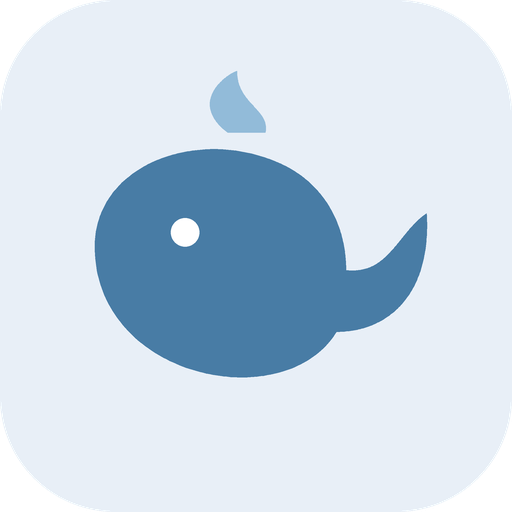
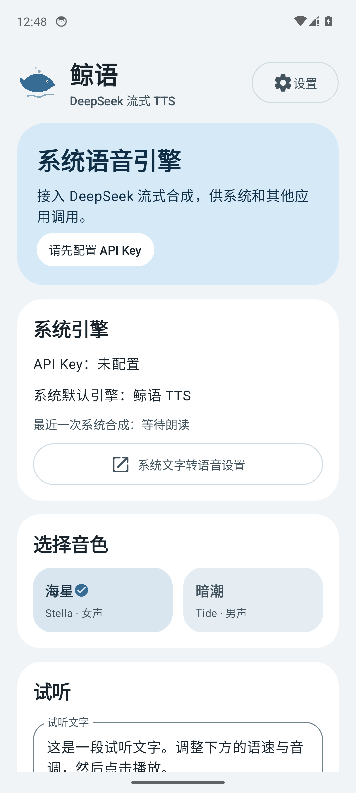
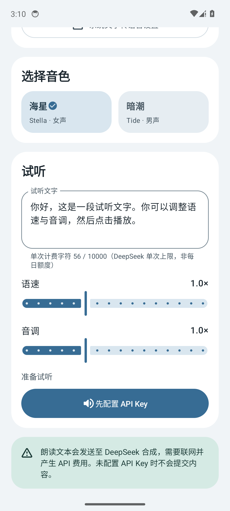
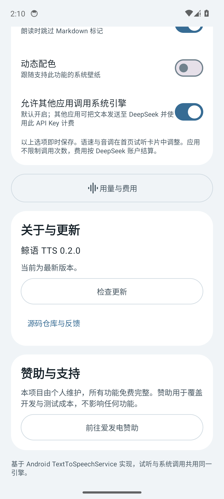
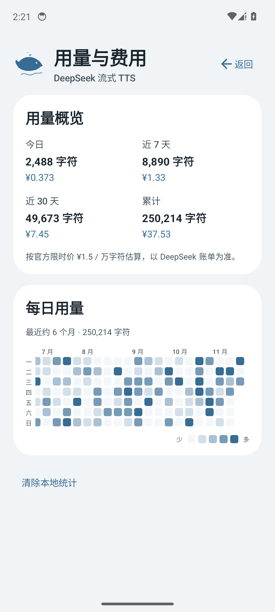
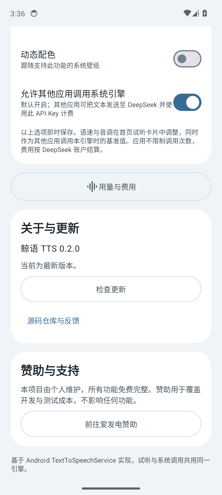
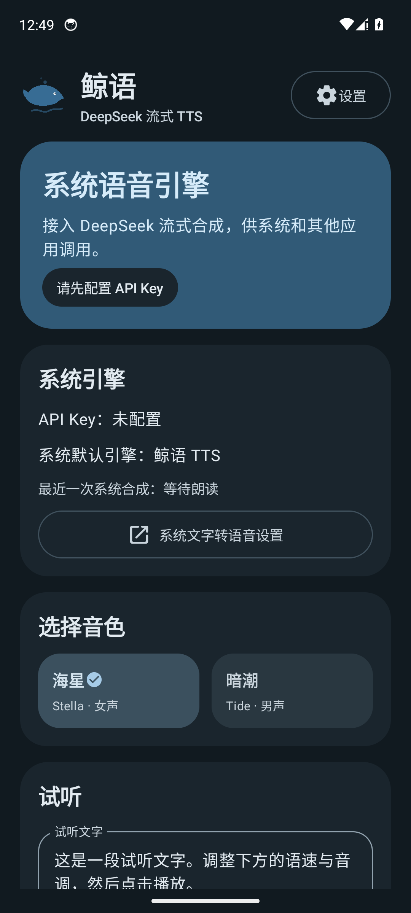

<div align="center">



# 鲸语 TTS

Android 系统文字转语音引擎，通过 DeepSeek 官方接口流式合成语音。

[](https://github.com/limao996/deepseek-tts/releases)
[](https://github.com/limao996/deepseek-tts/releases)
[](#快速开始)
[](LICENSE)
[](https://afdian.com/a/limao996)

[下载安装](#快速开始) · [界面预览](#界面预览) · [常见问题](#常见问题) · [隐私说明](docs/PRIVACY.md) · [验证说明](docs/VERIFICATION.md)

</div>

鲸语 TTS 实现 Android 的 `TextToSpeechService`，安装后可在系统「文字转语音输出」中设为首选引擎，由支持系统 TTS 的阅读器、听书应用和无障碍功能直接调用。朗读文本通过 DeepSeek 官方 WebSocket 接口流式合成，音频以 24 kHz PCM 边接收边播放，不必等整段合成完毕才开始出声。

## 赞助

本项目由个人维护。赞助用于覆盖开发、测试设备与签名证书等成本，不会解锁额外功能，也不影响任何已有功能。

[](https://afdian.com/a/limao996)

赞助入口同样位于应用「设置 → 赞助与支持」。赞助不会解锁功能，也不会改变朗读结果。

## 界面预览

<div align="center">
<table>
<tr>
<td align="center"><br/><sub>首页 · 引擎状态</sub></td>
<td align="center"><br/><sub>试听 · 计费字符提示</sub></td>
<td align="center"><br/><sub>设置 · 密钥与声音</sub></td>
</tr>
<tr>
<td align="center"><br/><sub>用量与费用 · 热力图</sub></td>
<td align="center"><br/><sub>设置 · 更新与赞助</sub></td>
<td align="center"><br/><sub>深色模式</sub></td>
</tr>
</table>
<sub>截图取自 Android 14 模拟器，界面随系统深浅色自动切换。</sub>
</div>

## 功能

| 能力 | 说明 |
| :-- | :-- |
| 系统 TTS 引擎 | 实现 `TextToSpeechService`，可被系统及其他应用绑定调用，而非只在应用内播放。 |
| 流式合成 | 通过 DeepSeek 官方 WebSocket 接收 24 kHz PCM 音频，收到即交给系统播放。 |
| 音色 | 提供 stella（女声）与 tide（男声）两种音色，切换后立即生效。 |
| 语速与音调 | 本地使用 Media3 Sonic 处理，范围 0.5–2.0 倍，不伪造服务端不支持的参数。设置中的值同时作为第三方应用调用时的基准：调用方未指定语速时使用此值，指定时按倍数叠加。 |
| 多语言 | 声明 10 种联网 Voice；实际语种由 DeepSeek 根据文本自动识别。 |
| 密钥保护 | API Key 经 Android Keystore AES-GCM 加密保存，界面不回显，备份与迁移排除该文件。 |
| 第三方调用 | 默认允许其他应用调用，可在设置中关闭。应用不限制朗读次数或每日用量。 |
| 用量与费用 | 统计今日、近 7 天、近 30 天与累计用量，并以热力图展示最近约 6 个月每日朗读量。 |
| 更新检查 | 优先解析 GitHub 发布页跳转，必要时调用 API；结果做缓存，避免触发限流。 |
| 朗读行为 | 断流或超时后不自动重播，不会产生重复请求与重复计费。 |
| 界面 | Material 3 Expressive，支持深色模式与动态取色。 |

## 快速开始

**1. 安装**

从 [Releases](https://github.com/limao996/deepseek-tts/releases/latest) 下载 APK。要求 Android 8.0 或更高版本；安装时可能需要允许安装未知来源应用。

**2. 配置 API Key**

打开「鲸语 TTS → 设置」，粘贴 [DeepSeek API Key](https://platform.deepseek.com/api_keys) 后点击「保存设置」。Key 仅保存在本机并加密存储，不会上传到其他服务器。

**3. 设为系统引擎**

在首页点击「系统文字转语音设置」，或在系统设置中搜索「文字转语音输出」，将首选引擎设为「鲸语 TTS」。部分厂商将该入口放在「无障碍 → 文字转语音输出」。应用不会也无法静默修改系统默认引擎。

**4. 第三方调用**

阅读器、听书等应用调用系统 TTS 时，文本会发送至 DeepSeek 并使用你保存的 API Key 计费。该能力默认开启；若只打算使用应用内试听，可在设置中关闭「允许其他应用调用系统引擎」。

## 用量与费用

设置页的「用量与费用」按计费字符统计今日、近 7 天、近 30 天和累计用量，并用周一对齐的 7 行热力图展示最近约 6 个月的每日朗读量。每格带日期与字符数的无障碍描述，五档颜色按统计窗口内的单日最大值分级。

DeepSeek 官方 TTS 刊例价为 ¥3 / 万字符，限时 5 折为 ¥1.5 / 万字符。界面按限时价估算，并注明以 DeepSeek 账单为准。

本地只记录日期、计费字符数与请求次数，不保存朗读文本、音频或请求日志。统计仅在服务确认合成成功后写入，失败或中断的请求不会计入；可随时清除本地统计，不影响账单。

应用不设每日用量上限；如需控制支出，请在 DeepSeek 控制台为 API Key 设置额度。

## 官方接口

应用仅连接 DeepSeek 官方接口 `wss://api.deepseek.com/v1/tools/tts`。代码中没有可替换的 base URL，也不支持中转站、镜像站或第三方兼容端点；建立连接前会校验目标地址，非官方域名会被拒绝（本地回环仅用于自动化测试）。请使用 DeepSeek 官方控制台签发的 API Key；使用中转或共享 Key 不在本项目管理范围内，语音质量、计费与隐私均无法保证。

本项目与 DeepSeek 无隶属关系，使用时需遵守 DeepSeek 服务条款。

## 隐私与安全

- API Key 由 Android Keystore AES-GCM 加密后存放在应用私有存储中，界面不回显已保存的密钥。
- 朗读文本与合成音频不写入本地，音频流直接交给系统播放。
- 用量统计仅记录日期、字符数与请求次数。
- Android 12+ 云备份与设备迁移规则显式排除密钥文件。
- 应用不含自建服务端、遥测与广告；外部链接均由用户主动点击。
- 设置页可清除 API Key、关闭第三方调用或清除本地统计；卸载后 Keystore 中的密钥不可用。

完整说明见[隐私说明](docs/PRIVACY.md)。

## 检查更新

设置页「关于与更新」支持自动与手动检查。实现先请求 `github.com/<repo>/releases/latest`，从 HTTP 302 的 `Location` 解析版本号；仅在取不到版本时才调用 GitHub API 兜底，并附带 `User-Agent`。结果缓存 6 小时，手动检查 30 秒内复用；收到 403/429 后冷却 30 分钟，期间提示用户手动打开仓库。检查更新只提示版本，不在应用内下载或安装。

## 技术架构

```text
阅读器 / 听书应用 / 无障碍
        │  speak()（系统 TTS 绑定）
        ▼
DeepSeekTtsService（TextToSpeechService）
        │  onSynthesizeText  ← 系统合成线程
        ▼
DeepSeekStreamSession（OkHttp WebSocket，有界队列 + 可取消背压）
        │  24 kHz / PCM 16-bit / 单声道二进制帧
        ▼
PcmFramer（跨帧采样对齐）→ PcmProcessor（Media3 Sonic 变速变调）
        │  SynthesisCallback.start / audioAvailable / done
        ▼
Android 系统音频输出
```

```text
app/src/main/java/io/github/deepseektts
├── data/      设置模型与 Keystore 加密存储
├── network/   官方消息协议、流式会话、取消与错误映射
├── audio/     PCM 采样对齐、Sonic 变速变调
├── billing/   计价与本地用量统计
├── update/    版本检查与缓存策略
├── engine/    系统 TTS 服务、Voice 目录、访问策略、平台 Activity
├── ui/        Compose 主题、组件、ViewModel
└── MainActivity.kt  首页 / 设置 / 试听 / 用量
```

只有收到服务端 `finish`/`success` 才算合成成功，提前断流按失败处理。发出 `finish_text` 后不再以短超时判断首帧，遵循协议给出的 60 秒无文本上限与 30 分钟会话上限。

## 本地构建

需要 JDK 17、Android SDK Platform 36，以及可访问 Google Maven 与 Maven Central 的网络。

```bash
# Windows
gradlew.bat :app:assembleDebug :app:testDebugUnitTest :app:lintDebug

# macOS / Linux
./gradlew :app:assembleDebug :app:testDebugUnitTest :app:lintDebug
```

调试 APK 输出于 `app/build/outputs/apk/debug/app-debug.apk`，也可直接用 Android Studio 打开项目。

## 验证情况

| 项目 | 结果 |
| :-- | :-- |
| JVM 单元测试 | 62 项通过 |
| Android 设备测试 | 15 项，其中 2 项真实网络测试默认跳过 |
| lint | 0 error，21 warning |

环境、覆盖范围与未验证事项见[验证说明](docs/VERIFICATION.md)。尚未在真机、Android 8 实机、TalkBack、200% 字体与横屏环境下验证。

## 常见问题

<details>
<summary>提示「第三方系统引擎调用已关闭」怎么办？</summary>

在设置中开启「允许其他应用调用系统引擎」。鲸语自身的试听不受该开关影响。
</details>

<details>
<summary>朗读失败并提示检查 API Key</summary>

确认 Key 有效、账户余额可用，且设备能访问 `api.deepseek.com`。错误提示会区分鉴权、限流、网络与超时。
</details>

<details>
<summary>系统设置里找不到「鲸语 TTS」</summary>

确认应用已安装并至少启动过一次；部分厂商将入口放在「无障碍 → 文字转语音输出」。
</details>

<details>
<summary>长文会被截断吗</summary>

单次请求上限由 DeepSeek 定义：10,000 计费字符（中文按 2 计，英文按 1 计）与 64 KiB。应用直接使用这一上限；Android 的 `TextToSpeech.speak()` 每次最多接受 4,000 字符，因此长文会在本地按句子边界切分后排队朗读，不会因超过 4,000 字符而失败。长文仍建议由调用方分段提交，应用内试听会实时显示计费字符数。这是单次请求限制，不是每日额度。
</details>

<details>
<summary>会重复朗读或重复计费吗</summary>

断流、超时与鉴权失败都不会自动重播，只有用户或调用方重新发起请求时才会产生新请求。
</details>

## 许可证

[MIT License](LICENSE) © 2026 limao996

---

<div align="center"><sub>本项目与 DeepSeek 无隶属关系，使用需遵守 DeepSeek 服务条款。</sub></div>
